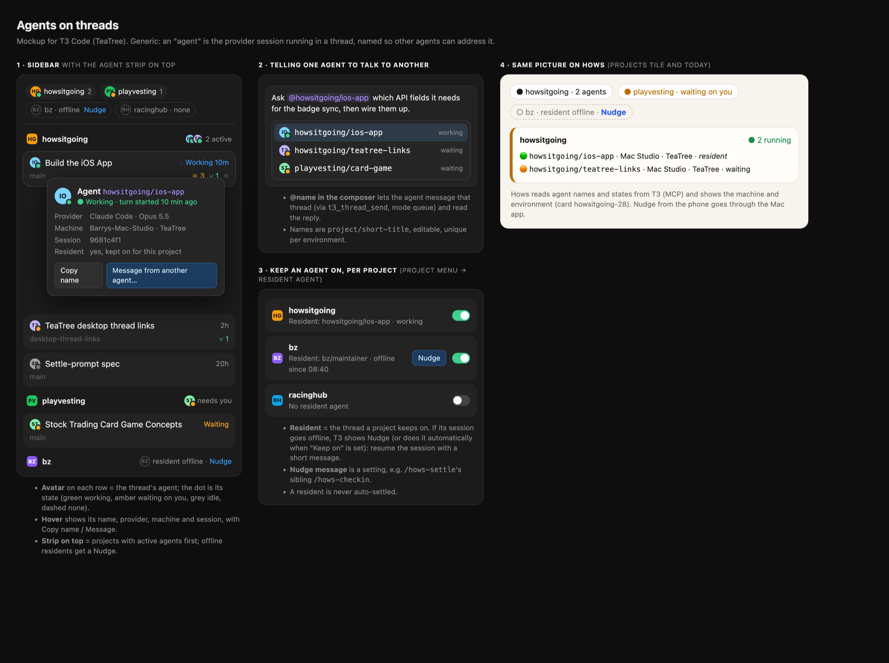

# T3 Code (TeaTree)

**Tea Tree Code: the Irish edition of T3 Code.** Say "T3" in a Dublin accent and you'll get it.

This is our own build of [T3 Code](https://github.com/pingdotgg/t3code): upstream plus a few features we want for how
we run agents, tracked as [issues](https://github.com/bogorman/t3code/issues?q=label%3Atea-tree) in this fork. The app
is labelled **T3 Code (TeaTree)** and installs beside the official one. Nothing here is specific to any one outside
tool: other tools talk to it through T3 Code's MCP server, links and settings.

## Our features

| Feature | Issue | Branch | State |
|---|---|---|---|
| **Thread links on the desktop:** `t3code://threads/<environmentId>/<threadId>` opens that thread, even with the window closed | [#4](https://github.com/bogorman/t3code/issues/4) | `desktop-thread-links` | built |
| **Message on settle:** a thread gets one more turn (e.g. a wrap-up skill) when it settles | [#5](https://github.com/bogorman/t3code/issues/5) | `settle-prompt` | built |
| **Thread badges** from outside tools (MCP), with a needs-you mark | [#6](https://github.com/bogorman/t3code/issues/6) | `thread-badges` | built |
| **Agents on threads:** live-agent state, agent names, agents strip, `@agent` mentions, keep an agent on, Nudge | [#7](https://github.com/bogorman/t3code/issues/7) | `thread-agents` | built |

Each feature has its own branch off upstream `main` and its commits reference the issue. Mockups live with the
feature under [`docs/tea-tree/`](docs/tea-tree/).

### Agents on threads



- **On each thread:** a dot on the provider icon shows its agent: working, needs you, idle or offline.
- **Hover card:** the agent's name (`project/thread-title`), its state, Copy, and Nudge when offline.
- **Agents strip:** above the list, projects with live agents, needing-you first; click to filter.
- **`@` in the composer:** finds threads by title or agent name, live agents first, so you can point one agent at
  another. Agents can also find each other with `t3_thread_list(agentName)` and message with `t3_thread_send`.
- **Keep agent on** (thread menu): never auto-settled; if its session goes offline, T3 sends the project's
  **Nudge message** (Settings → Thread behavior) to start it again.

## Branches

- `main`: upstream, unchanged.
- One branch per feature (above), generic and rebased onto upstream for each release.
- `tea-tree`: `main` + the feature branches + local-only commits (the TeaTree name, this README, `scripts/tea-tree/`).
  This is what we build.

## Build and install

```sh
scripts/tea-tree/build.sh          # rebase features onto upstream/main, rebuild tea-tree, build the DMG
scripts/tea-tree/build.sh v0.0.46  # same, on a release tag
scripts/tea-tree/seed-home.sh      # once: copy the official app's threads and settings into ~/.t3-teatree
```

The DMG lands in `release/`. It has no update feed, so the official updater never replaces it: rebuild when upstream
releases. Needs Node 24, pnpm 11 and Rust 1.95+.

**Data:** TeaTree has its own bundle id (`com.t3tools.t3code.teatree`) and folder (`~/.t3-teatree`), so the official
app's `~/.t3` is never touched and switching back is just opening the official app. Threads started in one app don't
show in the other, and the two shouldn't run at once (same port).

Full notes: [`scripts/tea-tree/NOTES.md`](scripts/tea-tree/NOTES.md).

---

## About T3 Code (upstream)

T3 Code is an "agent harness control surface". It enables control of the agents on your machine with a best-in-class mobile app ([iOS](https://apps.apple.com/us/app/t3-code-remote-claude-more/id6787819824), [Android](https://play.google.com/store/apps/details?id=com.t3tools.t3code)), [web app](https://app.t3.codes) and [Electron-based desktop app](https://t3.codes).

Works with your subscriptions on Claude Code, Codex, Cursor, Grok Build, OpenCode, and Google Antigravity. If they're set up on your computer, T3 Code can control them.

## "Wait, what are you selling me?"

Nothing. We built T3 Code because we wanted the best possible development experience with agents. We were inspired by existing solutions like the Codex desktop app, Conductor, Claude Desktop and Cursor Glass, but none met our bar.

We wanted something performant, remote-ready, and truly open. If we ever go the wrong direction, we want you to have everything you need to fork and build the editor that you want.

## Installation

> [!WARNING]
> T3 Code currently supports Codex, Claude, Cursor, Grok Build, OpenCode, and Antigravity. Install and authenticate at least one provider before use:
>
> - Codex: install [Codex CLI](https://developers.openai.com/codex/cli) and run `codex login`
> - Claude: install [Claude Code](https://claude.com/product/claude-code) and run `claude auth login`
> - Cursor: install [Cursor CLI](https://cursor.com/cli) and run `agent login`
> - Grok Build: install [Grok Build CLI](https://x.ai/cli) and run `grok login`
> - OpenCode: install [OpenCode](https://opencode.ai) and run `opencode auth login`
> - Antigravity: enable it in Settings, then use **Install Antigravity** and **Sign in with Google**. No CLI is required.

### Command line

```bash
curl -fsSL https://t3.codes/install.sh | sh
```

On Windows, in PowerShell:

```powershell
irm https://t3.codes/install.ps1 | iex
```

Then run `t3` to start the server and open the local web app. `t3 service install` keeps it running in the background, `t3 update` moves to a newer release, and `t3 --help` has the full reference.

To try it once without installing, run `npx t3@latest` instead.

### Desktop app

Install the latest version of the desktop app from [GitHub Releases](https://github.com/pingdotgg/t3code/releases), or from your favorite package registry:

#### Windows (`winget`)

```bash
winget install T3Tools.T3Code
```

#### Windows (`scoop`)

```bash
scoop install extras/t3code
```

#### macOS (Homebrew)

```bash
brew install --cask t3-code
```

#### Debian, Ubuntu (`.deb`)

Download the `.deb` from [GitHub Releases](https://github.com/pingdotgg/t3code/releases), then:

```bash
sudo apt install ./T3-Code-*.deb
```

#### Arch Linux (AUR)

Stable:

```bash
yay -S t3code-bin
```

Nightly:

```bash
yay -S t3code-nightly-bin
```

The AUR packaging is maintained in this repository under [`packaging/aur`](./packaging/aur).

## Some notes

We are very very early in this project. Expect bugs.

We are (mostly) not accepting contributions yet. Small fixes may be considered. Big features will not be.

## Documentation

Full docs live in [docs/](./docs). There's no docs site yet.

- [Install and first run](./docs/user/install.md)
- [Permission modes](./docs/user/permission-modes.md)
- [Keyboard shortcuts](./docs/user/keybindings.md)
- [Project settings](./docs/user/project-settings.md)
- [Appearance preferences](./docs/user/appearance.md)
- [Remote access from a phone or another machine](./docs/user/remote-access.md)
- [Connect Claude Code, Codex, ChatGPT and other agents over MCP](./docs/user/outside-agents.md)
- [Keeping app and server in sync](./docs/user/updating.md)
- [Source control integrations](./docs/user/source-control.md)
- Multiple accounts: [Codex](./docs/user/providers-codex.md) · [Claude](./docs/user/providers-claude.md)
- [Run T3 Code as a background service](./docs/user/background-service.md)

Building from source? Start at [docs/internals/overview.md](./docs/internals/overview.md).

## If you REALLY want to contribute still.... read this first

### Install `vp`

T3 Code uses Vite+ so you'll need to install the global `vp` command-line tool.

#### macOS / Linux

```bash
curl -fsSL https://vite.plus | bash
```

#### Windows

```bash
irm https://vite.plus/ps1 | iex
```

Checkout their getting started guide for more information: https://viteplus.dev/guide/

### Install dependencies

```bash
vp i
```

Read [CONTRIBUTING.md](./CONTRIBUTING.md) before reporting a bug or opening a PR.

Have a feature request? Start an [Ideas discussion](https://github.com/pingdotgg/t3code/discussions/categories/ideas).

Need support? Join the [Discord](https://discord.gg/jn4EGJjrvv).
